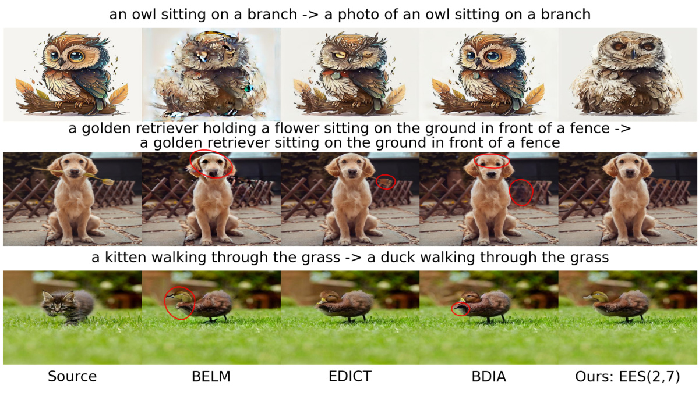

# Stable and Near-Reversible Diffusion ODE Solvers for Image Editing

Welcome to the codebase for the paper [_Stable and Near-Reversible Diffusion ODE Solvers for Image Editing_](https://arxiv.org/abs/2605.16399) by Barbora Barancikova, Daniil Shmelev and Cristopher Salvi (ICML 2026 Workshop on Structured Probabilistic Inference and Generative Modeling).



An image is edited by running the diffusion ODE backwards under a prompt that describes it and forwards again under the edited prompt.

| `--solver`                                          | Method                                       |
| --------------------------------------------------- | -------------------------------------------- |
| `ddim`                                              | DDIM inversion                               |
| `edict`                                             | EDICT (Wallace et al., 2023)                 |
| `bdia`                                              | BDIA (Zhang et al., 2024)                    |
| `belm`                                              | BELM (Wang et al., 2024)                     |
| `rex_euler`, `rex_midpoint`                         | Rex (Blasingame and Liu, 2025)               |
| `mccallum_foster_euler`, `mccallum_foster_midpoint` | McCallum and Foster (2024)                   |
| `reversible_heun`                                   | Reversible Heun (Kidger et al., 2021)        |
| `ees25`, `ees27`                                    | EES(2,5) and EES(2,7) (Shmelev et al., 2025) |

## Setup

```
pip install -r requirements.txt
```

The models are downloaded from the Hugging Face Hub on first use: Stable Diffusion 1.5 (`stable-diffusion-v1-5/stable-diffusion-v1-5`) with the [Smooth Diffusion](https://github.com/SHI-Labs/Smooth-Diffusion) LoRA (`shi-labs/smooth-diffusion-lora`) on top of it, which is the default for all solvers. Everything here was run on a single 12 GB GPU.

## Editing an image

```
python edit.py assets/kitten.jpg "a kitten walking through the grass" "a duck walking through the grass" --solver ees27
```

The image is from PIE-Bench. Every solver gets the same budget of network evaluations per pass (`--nfe`, 48 by default), so a solver with three evaluations per step takes 16 steps. The guidance scale is 3 by default.

Other options, see `python edit.py --help`:

- `--model stable-diffusion-v1-5/stable-diffusion-v1-5` uses plain Stable Diffusion 1.5;
- `--npi` uses negative-prompt inversion, and `--guidance_type proxedit` adds proximal guidance to it;
- `--prediction`, `--formulation` and `--schedule` choose the form of the ODE and the step spacing for the EES schemes and Reversible Heun. The defaults are the configurations used in the paper: the semilinear data-prediction ODE with steps uniform in logSNR for EES, and the black-box data-prediction ODE with steps uniform in t for Reversible Heun.

## PIE-Bench

Get PIE-Bench from the [PnPInversion](https://github.com/cure-lab/PnPInversion) authors and put it in `data/PIE-Bench_v1`, so that `data/PIE-Bench_v1/mapping_file.json` exists.

```
python benchmark.py --solver ees25
python evaluate.py results/small_edits/ees25_steps16_g3.0
```

The first command edits all 700 images with the prompt pairs of the benchmark (_small edits_ in the paper), the second appends the background preservation and CLIP metrics to `results/evaluation_small_edits.csv`. For the _large edits_, where the target prompt is the prompt of another image, add `--task large` to both commands. `--categories` restricts the run to some of the ten editing categories.

PickScore and ImageReward need older packages and so their own environment:

```
pip install -r requirements-rewards.txt
python evaluate_rewards.py results/small_edits/ees25_steps16_g3.0
```

## Reconstruction

With the MS COCO 2014 validation images and captions in `data/coco2014`:

```
python reconstruction.py --solver ees25 --guidance_scale 1.0
```

This inverts 100 images under their caption, regenerates them under the same caption and appends the mean squared error, in the latent and in pixels scaled to [0, 1], to `results/reconstruction.csv`.

## Citation

```
@inproceedings{
barancikova2026stable,
title={Stable and Near-Reversible Diffusion {ODE} Solvers for Image Editing},
author={Barbora Barancikova and Daniil Shmelev and Cristopher Salvi},
booktitle={ICML 2026 Workshop on Structured Probabilistic Inference {\&} Generative Modeling},
year={2026},
url={https://openreview.net/forum?id=lfmBt6bzWZ}
}
```

## Acknowledgements

The DDIM, EDICT, BDIA and BELM samplers are adapted from [BELM](https://github.com/zituitui/BELM), the noise schedule from [DPM-Solver](https://github.com/LuChengTHU/dpm-solver), and the evaluation from [PnPInversion](https://github.com/cure-lab/PnPInversion). See `NOTICE`.
